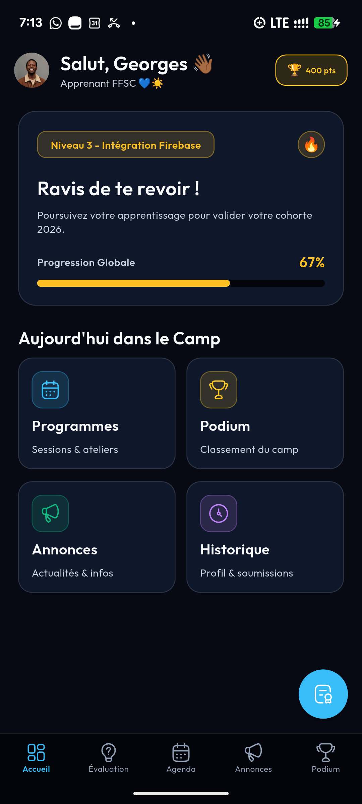
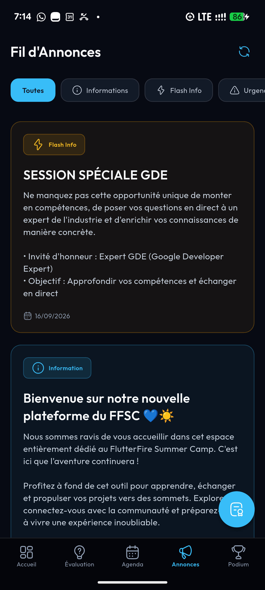
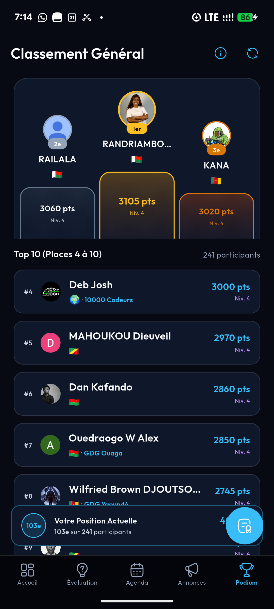

# My FFSC 💙☀️ - Portail Apprenant FlutterFire Summer Camp

[](https://github.com/FlutterFireCamp/myffsc/actions)
[](https://flutter.dev)
[](https://firebase.google.com)
[](https://bloclibrary.dev)
[](LICENSE)

**My FFSC 💙☀️** est l'application portail officielle destinée aux apprenants du **FlutterFire Summer Camp**, un programme d'immersion totale et de mentorat intensif pour propulser les futurs leaders de la tech en Afrique Francophone.

> **Repository Officiel** : [https://github.com/FlutterFireCamp/myffsc.git](https://github.com/FlutterFireCamp/myffsc.git)

---

## 📱 Aperçu de l'Application

<p align="center">
  
  &nbsp;
  
  &nbsp;
  
</p>

---

## Fonctionnalités Clés

- **Authentification et Contrôle d'Accès** : Authentification sécurisée via Google Sign-In avec vérification automatique des autorisations de l'apprenant. Les comptes en attente ou non autorisés sont redirigés vers un écran d'accès restreint.
- **Gestion de Profil et Niveaux** : Photo de profil Google/avatar dynamique, suivi du statut d'acceptation, liens réseaux sociaux (Discord, GitHub, LinkedIn, Twitter/X) et historique complet des évaluations avec correction interactive.
- **Tableau de Bord Dynamique** : Salutation personnalisée, suivi de progression par niveau adaptatif (Niveaux 1 à 4), résumé des points FFSC et accès rapide au programme du jour.
- **Agenda et Programmes** : Consultation des sessions, workshops, conférences et groupes d'études avec conversion automatique des horaires GMT vers le fuseau horaire de l'appareil.
- **Annonces en Temps Réel** : Fil d'actualité filtré par priorité (Urgent, Important, Info) et par niveau, avec support Markdown riche.
- **Podium et Classement** : Classement en direct des participants avec Top 3 sur socles distincts, suivi du Top 10 et barre sticky du rang de l'utilisateur connecté.
- **Test et Évaluation du Jour** : Épreuve chronométrée en temps réel avec questions à choix multiples (QCM) ou ouvertes, gestion automatique du temps additionnel, détection d'arrière-plan anti-triche et soumission atomique sur Firestore.
- **Hub de Formulaires & Certificats** : Accès rapide aux formulaires officiels (signalements, retours de sessions, suggestions) et validation des certificats.

---

## Architecture du Projet

L'application respecte les principes de la **Clean Architecture** combinée au pattern **BLoC** (*Business Logic Component*) :

```text
lib/
├── app.dart                    # MaterialApp.router et configuration Sizer
├── main.dart                   # Initialisation Firebase, Crashlytics, GetIt et point d'entrée
├── firebase_options.dart       # Configuration multi-plateformes Firebase
├── core/                       # Ressources globales et transverses
│   ├── core.dart               # Export barrel global du noyau
│   ├── helpers/                # LevelConfig, DateTimeHelper, NetworkHelper
│   ├── routes/                 # Navigation déclarative GoRouter et constantes RoutePaths
│   ├── theme/                  # Couleurs (AppColors), typographie Outfit, AppRadius
│   ├── di/                     # Injection de dépendances via GetIt
│   ├── error/                  # Gestion fonctionnelle des erreurs (fpdart)
│   ├── services/               # NotificationService (FCM)
│   └── widgets/                # Composants UI partagés, EmptyState, Shimmers
└── features/                   # Modules métiers indépendants (Data, Domain, Presentation)
    ├── auth/                   # Connexion Google, synchronisation profil et vérification rôle
    ├── dashboard/              # Accueil interactif et métriques
    ├── programs/               # Agenda des sessions et filtres par type
    ├── announcements/          # Flux d'actualités et filtres
    ├── podium/                 # Classement général, Top 3 et Top 10
    ├── tests/                  # Évaluation du jour, QCM chronométré et résultats
    ├── profile/                # Profil, liens sociaux, historique d'évaluation
    ├── forms/                  # Menu d'accès aux formulaires et certificats
    └── shared/                 # Navigation principale avec barre d'onglets persistante
```

---

## Démarrage Rapide

### Prérequis

- [Flutter SDK](https://flutter.dev/docs/get-started/install) (v3.29.0 ou supérieure)
- [Dart SDK](https://dart.dev/get-dart)
- [Firebase CLI](https://firebase.google.com/docs/cli) et [FlutterFire CLI](https://firebase.google.com/docs/flutter/setup)
- Projet Firebase configuré (Authentication, Firestore, Cloud Messaging, Crashlytics)

### 1. Cloner le projet

```bash
git clone https://github.com/FlutterFireCamp/myffsc.git
cd myffsc
```

### 2. Installer les dépendances

```bash
flutter pub get
```

### 3. Configurer Firebase pour le développement

Le dépôt contient des modèles de configuration prêts à l'emploi :
- `lib/firebase_options.dart.example`
- `android/app/google-services.json.example`
- `ios/Runner/GoogleService-Info.plist.example`

Pour lier votre propre projet Firebase de test ou développement :

```bash
dart pub global activate flutterfire_cli
flutterfire configure --project=YOUR_FIREBASE_PROJECT_ID
```

Activez **Google Auth**, **Cloud Firestore** et **Crashlytics** sur votre console Firebase.

### 4. Lancer l'application

```bash
# Pour Android
flutter run -d android

# Pour iOS
flutter run -d ios
```

---

## Tests, Formatage et Analyse du Code

Pour garantir la qualité du code et l'absence de régressions lors des contributions :

```bash
# Vérifier la conformité du formatage standard Dart
dart format --output=none --set-exit-if-changed .

# Analyse statique du code (0 avertissement requis)
flutter analyze

# Lancement de la suite complète de tests unitaires et BLoC
flutter test
```

---

## Contribution au Projet Open-Source

Les contributions des Google Developer Experts (GDEs), mentors, développeurs Flutter et membres de la communauté sont vivement encouragées !

Consultez le fichier [CONTRIBUTING.md](CONTRIBUTING.md) pour connaître les conventions de code, la stratégie de branches et le workflow de Pull Request.

---

## Sécurité

Pour signaler une vulnérabilité de sécurité, envoyez un rapport privé à **hello@flutterfirecamp.dev** ou consultez notre [Politique de Sécurité](SECURITY.md).

---

## Licence

Ce projet est sous licence MIT - voir le fichier [LICENSE](LICENSE) pour plus de détails.
